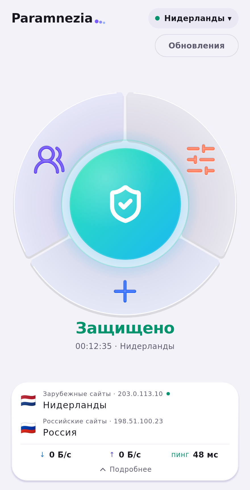
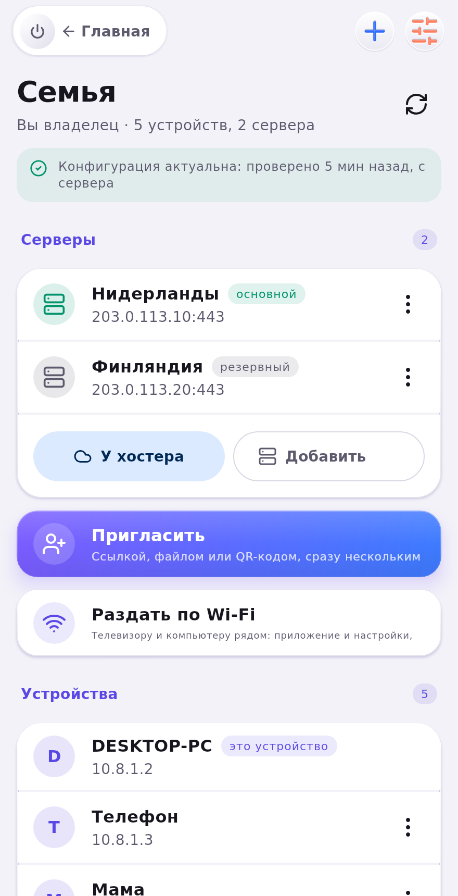

# Paramnezia

**Семейный VPN на вашем сервере.** Вы настраиваете подключение и отправляете близким приглашение. На их телефонах и компьютерах появляется кнопка включения VPN. Когда у сервера меняется адрес, вы обновляете его для всей семьи в одном месте.

[Скачать для Android · APK](https://github.com/zazzool/paramnezia/releases/latest/download/paramnezia.apk) · [Скачать для Windows · EXE](https://github.com/zazzool/paramnezia/releases/latest/download/Paramnezia-Setup.exe) · [Что нового](https://github.com/zazzool/paramnezia/releases/latest)

Для собственного VPN понадобится Linux-сервер с доступом по SSH. Если у вас уже есть приглашение от близкого человека, достаточно открыть ссылку и следовать подсказкам.

| Главное окно | Управление семьёй |
| --- | --- |
|  |  |

*Экраны приложения для Windows с демонстрационными данными.*

## Как это выглядит дома

**Вы настраиваете VPN родителям.** На своём устройстве создаёте одноразовое приглашение и отправляете ссылку. Родители открывают её на телефоне. После вступления Paramnezia показывает простой экран подключения. Доступ каждого устройства можно отозвать отдельно. [Установка и приглашения](docs/USAGE.md)

**Хостер поменял IP.** Вы сохраняете новый адрес в семейных настройках. Устройства получают подписанное обновление при синхронизации. Заранее подключённое HTTPS-зеркало позволяет получить настройки и при недоступности старого сервера. Если кто-то пользуется обычной AmneziaVPN, для него можно настроить постоянное DNS-имя. При смене ключей или порта такому устройству понадобится обновлённый профиль. [Смена адреса и переезд на новый сервер](docs/OWNER.md)

**Банк и браузер работают через разные маршруты.** Российские сайты и выбранные приложения могут выходить напрямую, а остальной трафик — через VPN. На главном экране можно проверить, какие адреса видят внешние сервисы. [Маршруты и настройки Windows](docs/WINDOWS.md)

## Первый запуск

1. **Уже есть ключ или файл настроек?** Откройте «Добавить» и импортируйте ключ AmneziaVPN, QR-код или файл WireGuard/AmneziaWG.
2. **Начинаете со своего VPS?** В разделе «Добавить» выберите свой сервер и укажите SSH-доступ. Paramnezia установит серверную часть AmneziaWG. Расходы на VPS оплачиваются хостеру. [Требования к серверу](docs/SERVER.md)
3. **Хотите подключить близких?** Откройте «Семья», добавьте сервер в группу и создайте приглашение. Перед сменой IP проверьте на втором устройстве, что оно уже получило настройки резервного канала. [Руководство владельца](docs/OWNER.md)

## Платформы и совместимость

| Устройство | Как подключиться |
| --- | --- |
| Android | Установите официальный APK из релиза. Владелец может управлять серверами и приглашениями со смартфона. |
| Windows 10 и 11 | Установите приложение из того же выпуска. Доступны семейная группа, импорт профилей и выбор приложений для прямого соединения. |
| iPhone | Откройте приглашение и импортируйте выданный профиль в AmneziaVPN. Семейная синхронизация Paramnezia доступна в её собственных клиентах. |

## Для разработчиков и операторов

Семейные настройки шифруются и подписываются на устройстве администратора. Клиенты проверяют подпись перед применением. Для обновлений самого приложения используются отдельные подписанные манифесты Android и Windows. [Архитектура](docs/ARCHITECTURE.md) · [Форматы и протоколы](docs/PROTOCOLS.md)

- [Сборка, тесты и CI](docs/DEVELOPMENT.md)
- [Подпись и публикация релиза](docs/RELEASE.md)
- [Серверная часть зеркала и DNS](tools/psync-server/README.md)
- [Параметры AmneziaWG](docs/CAMOUFLAGE.md)
- [Разрешения Android и проверки сборки](docs/PLAY-PROTECT.md)
- [Сторонние компоненты и лицензии](THIRD-PARTY-NOTICES.md)
- [Описание проекта и изображения для публикаций](docs/PRESS.md)
